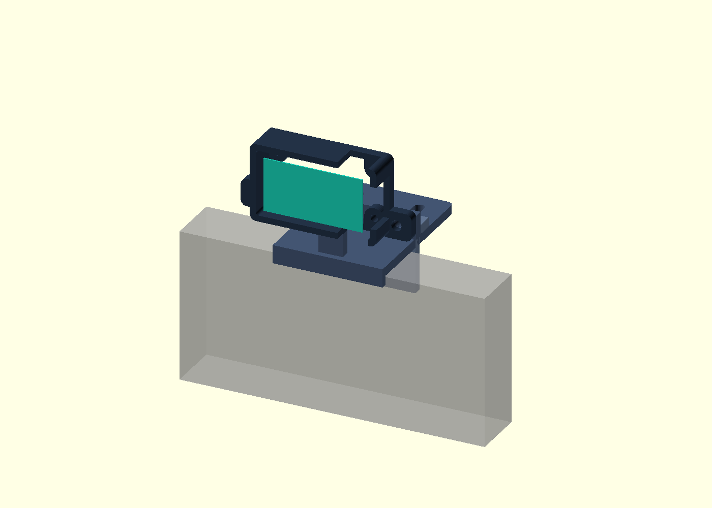

# Waveshare ESP32-C6-LCD-1.47: backlight-only investigation

**Unresolved. Paused on 2026-10-09. No working LCD fix was found.**

This repository preserves a long, unsuccessful display investigation so another person or AI coding agent can resume from evidence instead of repeating it. It is an investigation handoff, **not a proven setup guide, known-good firmware release, or diagnosis of defective hardware**.

The device is the **non-touch, 4 MB Waveshare ESP32-C6-LCD-1.47**. USB flashing and application execution work, and software can control the backlight. The LCD never reliably displayed the requested text, colors, or circle. The owner reports it worked with a previous project before this investigation. We did not establish why it stopped displaying pixels.

## Start here

1. [Investigation and lessons](docs/INVESTIGATION.md): goals, what went right/wrong, observations and uncertainty.
2. [Test matrix](docs/TEST_MATRIX.md): major attempted approaches and their evidence limits.
3. [Agent handoff](docs/AGENT_HANDOFF.md): current state, guardrails and useful next questions.
4. [Evidence index](evidence/README.md): selected serial logs, historical binary hashes and material intentionally kept private.
5. [Sources](docs/SOURCES.md): manufacturer documentation, forum report and pinned driver references.

For an agent, paste this:

> Read README.md, AGENTS.md, docs/INVESTIGATION.md, docs/TEST_MATRIX.md, docs/AGENT_HANDOFF.md and evidence/README.md. Treat this as historical context for an unresolved non-touch Waveshare ESP32-C6-LCD-1.47 investigation. First explain what is established, what remains uncertain, and which new test would distinguish competing explanations. Do not assume a serial ACK proves pixels appeared. Do not access hardware or flash anything unless I ask you to resume testing.

## Final verified state

| Layer | Result |
|---|---|
| Build and upload | Actual ESPHome 2024.11.0 / ESP-IDF 5.1.2 built and flash data verified |
| Application startup | Successful after a USB logging workaround; repeated `ALIVE circle test` |
| LCD configuration | CUSTOM ST7789V, 172 × 320, offset 34, SPI mode 3 at 4 MHz, explicit GPIO22 backlight |
| Backlight control | Brightness changes visibly; final diagnostic dims to approximately 12% after 30 seconds |
| Display output | Six webcam captures through 45 seconds: **no circle or convincing drawn pixels** |
| Root cause | Unknown; no hardware defect or controller mismatch established |
| Project disposition | Owner stopped testing and planned to put the device in storage; no further hardware actions requested |

The final diagnostic was left installed. That is the last observed state, not a guarantee about a device retrieved from storage later. The USB logging fix solved an ESPHome startup crash, **not the LCD problem**.

## Useful work retained

- [Final ESPHome configuration](firmware/esphome_forum/README.md), including the logger workaround and exact display settings.
- [Independent MicroPython reference example](firmware/micropython_reference/README.md), with pinned external driver instructions.
- [Codex usage bridge prototype](bridge/README.md), with unit tests and no account data. Live percentage retrieval worked historically; a functioning physical usage screen was never achieved.
- [Monitor-top enclosure prototype](enclosure/README.md): editable OpenSCAD, three STL parts and CAD preview for an approximately 18 mm monitor. Geometry was checked; it was **not printed or physically fitted**.

## Publication scope

This is a curated public snapshot, not the entire local workspace or chat transcript. Raw flash dumps may contain another project's credentials or configuration and are not published. Personal paths, unique USB identifiers, account usage, full toolchains, third-party demo bundles and raw webcam photographs are also excluded. Local backups and detailed evidence were preserved separately.

The selected source files are reference artifacts. They do not start a bridge, install a startup task or flash hardware simply by cloning this repository. Some historical diagnostics and their full logs are described but not bundled; the evidence index makes that distinction explicit.

Original documentation, prototype code and CAD in this repository are available under the [MIT license](LICENSE). External dependencies and linked vendor/third-party materials retain their own licenses; see [NOTICE](NOTICE.md).
